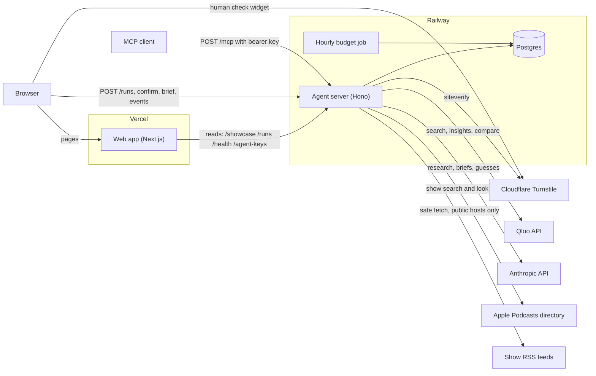
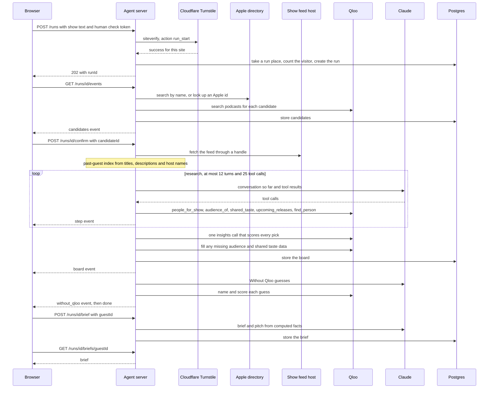
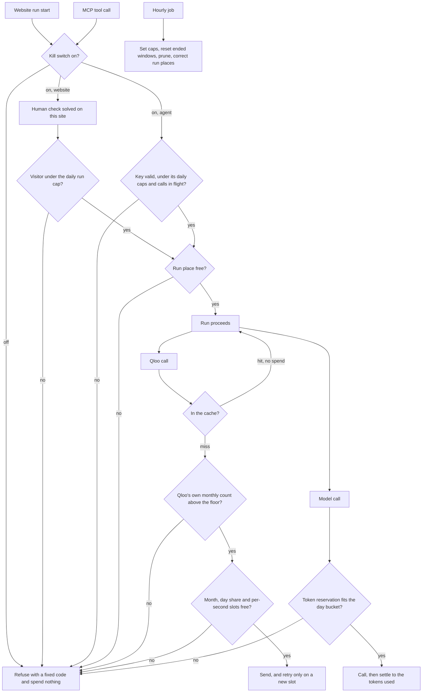

# Vasal architecture

Vasal is a podcast guest booker. A host types a show, and Vasal returns a ranked board of guests whose fans already match the show's listeners on Qloo's taste graph, with a booking brief and a pitch draft for each. The browser talks to a Next.js web app on Vercel and straight to an agent server on Railway. The agent server holds the Qloo and Anthropic keys, the Postgres database and every spending check. Everything below describes what the code in this repository does.

## The system

The web app serves the pages and reads finished runs from the agent server. The browser starts runs, follows their events and asks for briefs by calling the agent server directly, so every check that protects spending lives in the agent server. Agents reach the same server at `/mcp` with a bearer key. Postgres holds runs, boards, briefs, the Qloo cache, the spending counters and the on/off flags. An hourly job on Railway sets the day's caps, prunes expired rows and corrects the run counters.

## One run

A run has two halves because the host confirms which show they meant. The first half starts at `POST /runs` and ends with a list of candidate shows. The second half starts when the host confirms one and ends with the board. Briefs come later, one guest at a time, on request. The event stream sends each step as it happens, and a saved run replays the same events.

## Where the money is guarded

Every Qloo call and every model call reserves from a counter in Postgres before it goes out, in one statement that adds to the counter only if the total stays under the cap. A Qloo call takes one slot from the month, the day share and the current second together, or none at all. Model tokens are reserved before the call and settled to the tokens the reply reports. Visitors and agent keys have their own daily caps, and the number of runs in progress is capped across the site. The hourly job rolls the day and month windows and sets the caps from `packages/agent/scripts/budget-policy.json`.

## What the web app reads and writes

The web app has no database and no secret. It reads from the agent server in two places. Server components read on Vercel through `VASAL_API_URL`, which the browser never sees. The browser calls the same server directly through `NEXT_PUBLIC_VASAL_API_URL`. Both default to `https://api.vasal.site`.

| Route | Method | Called from | What the web app does with the answer |
| --- | --- | --- | --- |
| `/health` | GET | Server | Reads `ok` and `liveRuns` to show whether live runs are open. Any failure counts as closed. |
| `/showcase` | GET | Server | Lists the promoted runs for the home page and the "is this run on the showcase" test. |
| `/runs/:id` | GET | Server | Renders a saved run page: board, kolam drawing, past-guest coverage and the Without Qloo flip. The home page reads one fixed showcase run the same way. |
| `/runs/:id/events` | GET | Server | Reads the stored events once and keeps only the `step` events for the run page's step list. |
| `/runs/:id/briefs/:guestId` | GET | Server | Reads each guest's stored brief while rendering a run page. |
| `/agent-keys` | GET | Server | Reads whether keys are open and the limits each key carries, for the agents page. |
| `/runs` | POST | Browser | Starts a run with the show text and the human check token. Stores the returned `runId`. |
| `/runs/:id` | GET | Browser | Polls the run's status when the event stream cannot be used. |
| `/runs/:id/events` | GET | Browser | Follows the run live as server-sent events: `step`, `candidates`, `board`, `done`, `failed`. |
| `/runs/:id/confirm` | POST | Browser | Sends the candidate the host picked. |
| `/runs/:id/brief` | POST | Browser | Asks for one guest's brief and pitch. |
| `/runs/:id/briefs/:guestId` | GET | Browser | Polls until the brief is written. |
| `/agent-keys` | POST | Browser | Sends the human check token and shows the returned key once. |
