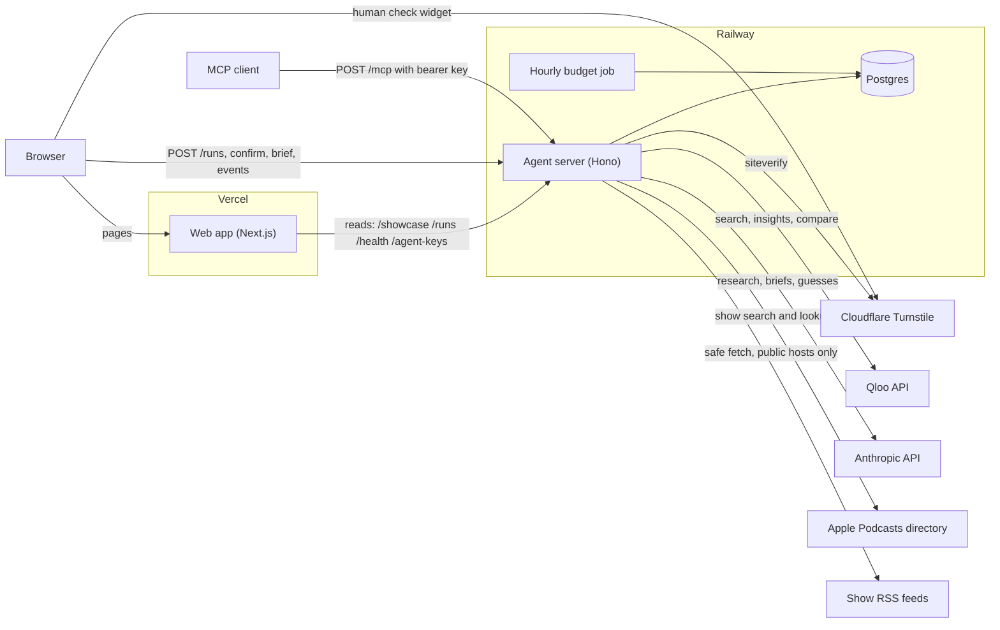
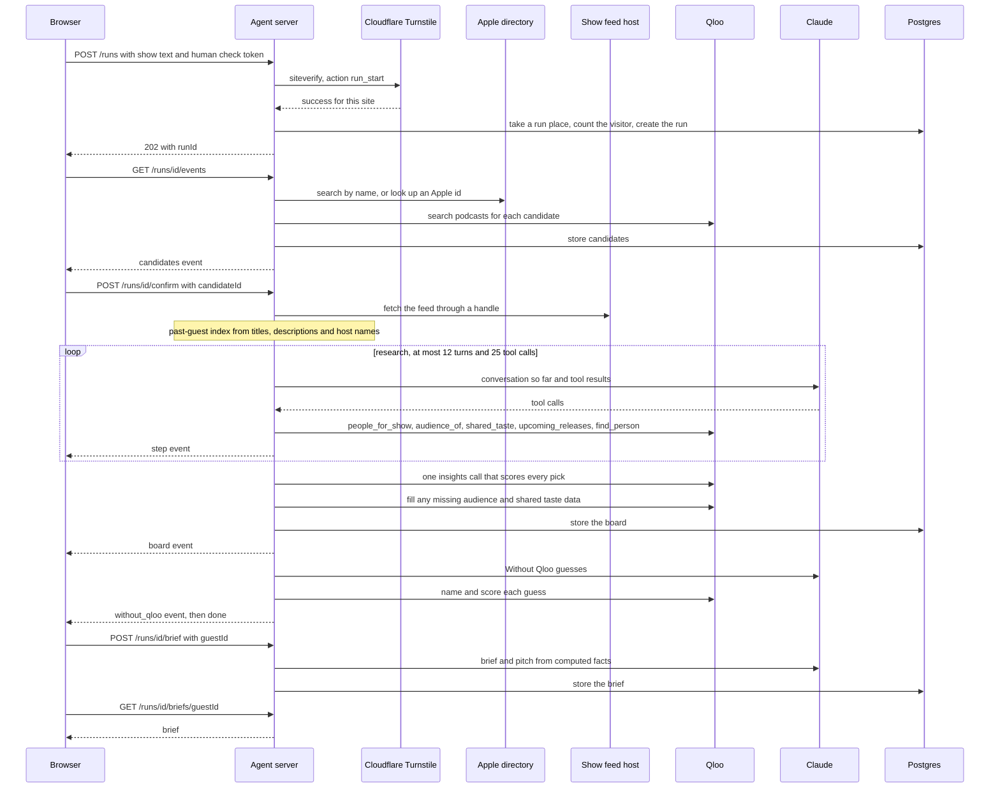
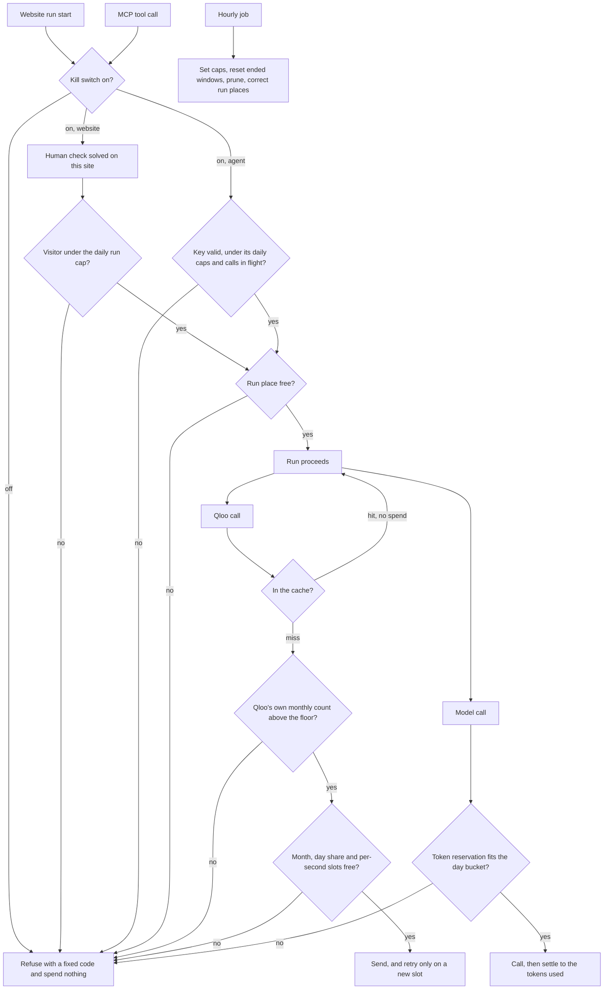

<p align="center">
  
</p>

# Vasal

We help podcast hosts book the guests their listeners already love, and the ones who bring new listeners.

Vasal is the doorway of a Tamil home, where a kolam is drawn each morning to welcome guests.

[Live app](https://vasal.site) | [Docs](https://vasal.site/docs) | [Proof](https://vasal.site/proof) | [Agent keys](https://vasal.site/agents)

## Live deployments

| Part | Where it runs | Address |
| --- | --- | --- |
| Web app | Vercel | https://vasal.site |
| Agent API | Railway | Base address `https://api.vasal.site` (the bare root answers 404 by design). Health check: https://api.vasal.site/health |
| MCP endpoint | Railway | https://api.vasal.site/mcp (POST only, with a bearer key from https://vasal.site/agents) |
| Saved board 1 | Saved run | [This Week in Startups](https://vasal.site/runs/915764d5-a8d9-4249-8f1b-9e779ceff2ea) |
| Saved board 2 | Saved run | [Conan O’Brien Needs A Friend](https://vasal.site/runs/f59e082d-c815-4083-81c7-24e8df435f4b) |
| Saved board 3 | Saved run | [New Heights with Jason & Travis Kelce](https://vasal.site/runs/cac01626-151e-435c-87f8-aa31937d89f1) |
| Saved board 4 | Saved run | [The Diary Of A CEO with Steven Bartlett](https://vasal.site/runs/ea7d8846-ebc9-46a7-a554-3b7502856ceb) |
| Saved board 5 | Saved run | [Las Culturistas with Matt Rogers and Bowen Yang](https://vasal.site/runs/844cb44a-f4d4-43c9-bc72-206d3d65e1a0) |
| Saved board 6 | Saved run | [Lex Fridman Podcast](https://vasal.site/runs/a312ada8-e216-41c3-bb97-b0bf66a2a1d6) |
| Saved board 7 | Saved run | [Armchair Expert with Dax Shepard](https://vasal.site/runs/9c2c8fbb-6772-40c1-b965-d9441576c8dd) |

The seven boards are real runs that the operator checked by hand and saved, so they open at once and cost nothing to read. Live runs, where you type your own show, open on 30 October 2026, when judging starts. The operator can switch them off to protect the shared Qloo quota, and the home page says which. Saved boards always work. The list above was read from `GET /showcase` on 27 October 2026.

## Overview

Vasal is for the host and producer of a mid-size podcast. Every week they decide who to invite next, and most of the time they decide from memory, from the news and from whoever the last guest suggested. The risks are a guest whose fans are not their listeners, and a guest who has already been on the show.

The money follows the guests. Podcast ads are sold by the thousand downloads, so a guest who brings listeners is worth more than a famous name who does not. We tested the idea on 755 episodes of eight large shows. Episodes in the top fifth by guest fit drew 1.55 times the median adjusted views of those in the bottom fifth. The link is small (a correlation of 0.14) and it shows association, not cause. The method was written down and committed before any data was pulled, and the full write-up is in [docs/backtest-results.md](docs/backtest-results.md).

A host types the name of their show. Vasal asks [Qloo](https://www.qloo.com/), a taste graph that links people, shows, films and books through the audiences they share, which people the show's listeners already love. It scores each finalist against the show on one scale, checks every name against the show's own episode feed so past guests and hosts are left out, and returns a ranked board. Each guest has a brief with five questions and a pitch email draft, written when the host asks. A "Without Qloo" tab on every board shows what the same model suggests alone: on the seven saved boards, 41 of its 56 guesses had already been on the show or host it. There is no account and no price today.

| | How hosts book guests today | With Vasal |
| --- | --- | --- |
| Who to ask | Your memory, a booker's list, or the last guest's suggestion | Qloo returns up to 20 people per question whose fans overlap the show's listeners, and the agent picks 3 to 10 finalists |
| How fit is judged | Name recognition and gut feel | One Qloo call scores every finalist against your show, so all the fits sit on one scale and show as a percentage |
| Past guests | You check your own archive by hand | Every name is checked against the episode titles, descriptions and host names in your show's feed, and the page says how far back the check reached |
| What you get to send | An email you write from scratch | A brief with five questions and an email draft, labelled as an AI draft. Vasal never sends it |
| How long it takes | As long as your research takes | About a minute for a board, then about fifteen seconds for each brief |

## What it does

### Find the right show

The host types a show name, an Apple Podcasts link or an RSS feed link. For a name, Vasal asks Apple's podcast directory for up to five matches, then asks Qloo's `/search` for the podcast behind each one. A candidate stays only if exactly one Qloo podcast matches its name. The host picks the right show, and the browser sends back only an id the server issued for that run, never a link or a name, so it cannot steer the server to fetch something else.

### Rank guests by Qloo fit

A language model, Claude Haiku 5.5, decides which questions to ask. It has five Qloo tools:

- `people_for_show` calls `/v2/insights` for up to 20 people whose fans overlap the show's audience.
- `audience_of` calls `/v2/insights` with `filter.type=urn:demographics`, to find the age and gender groups a guest's fans lean toward more than the show's listeners do.
- `shared_taste` calls `/v2/analysis/compare` for the tastes the two audiences share.
- `upcoming_releases` calls `/v2/insights` for films, TV shows and books the audience is likely to care about, to steer which people the model researches.
- `find_person` looks up a name through Qloo's own harness package, `@qloo/qloo-harness`, which calls `/search` and then `/entities`.

The model then picks 3 to 10 finalists, and code does the rest. One final `/v2/insights` call scores every finalist against the show, so the fits compare with each other. Guests rank by that score, with ties broken by lower popularity. A guest at Qloo popularity 0.97 or above gets a "household name" label, because Qloo's popularity could not tell a famous guest from an unknown one below that line. The model writes a one-sentence angle per guest and never writes a number. Whether a guest is rising is shown as unknown, because Qloo's hackathon host returned no trend data on 21 October 2026, so the trend tool is switched off rather than guessed.

### Check who has already been on

When the host confirms a show, the server reads its feed, up to the newest 2,000 episodes, and builds an index of episode titles, descriptions and the names of the people who make the show. Every person Qloo returns is checked against it, and a match removes them for the rest of the run. A title or host entry matches when it holds every word of the name; a description matches only on the whole name. The page states how far back the check reached, and says so when the feed could not be read. For a show whose feed no longer reaches its first episodes, the operator can add older titles by hand. The first saved board does that for 6,230 older titles, and the run page shows both counts.

### Brief and pitch on demand

A brief is written for one guest at a time and stored. It holds why the guest suits the show, an angle, five questions, an email subject and an email body under about 150 words. The model writes with placeholders and code fills in every name and number afterwards. Code refuses any digit and a list of common number words, removes links and email addresses, and refuses claims about a guest's release schedule, family, sensitive traits or legal trouble. A draft that fails a check is written again once. A run can write at most five briefs.

### The Without Qloo flip

Every board has a "Without Qloo" tab. The same model is asked for guests with no Qloo data, up to eight of them. Vasal then searches Qloo for each guess, scores it, and checks it against the show's episode history the same way as the board. The tab reports how many of the guesses had already been on the show or host it.

### The proof

The [proof page](https://vasal.site/proof) and [docs/backtest-results.md](docs/backtest-results.md) report a pre-registered test. It asked whether Qloo guest fit predicts YouTube episode views across 755 episodes of 8 large podcasts. The pooled Spearman correlation was 0.140 (95% interval 0.069 to 0.211), and 0.096 (0.021 to 0.173) with the guest's general fame held fixed. It is a small, correlational result. It does not show that fit causes views, YouTube views are not podcast downloads, and the eight shows are among the largest, not the mid-size shows Vasal is built for. The method is in [docs/backtest-preregistration.md](docs/backtest-preregistration.md).

### The agent door (MCP)

Any MCP client can call Vasal at `https://api.vasal.site/mcp` with a bearer key. A person gets a key at [/agents](https://vasal.site/agents) after one human check. Four tools cover the same flow as the site: `find_show`, `book_guests`, `get_board` and `write_brief`. Agents spend from their own daily share of the budget, so they cannot use what the website needs.

### Limits

- Qloo knows audiences for some people and not others. Of the 47 guests on the seven saved boards, 19 show a group their fans lean toward, and the first saved board shows none.
- The fit score is Qloo's affinity between two audiences. It says nothing about whether a guest will say yes.
- Vasal does not claim a guest has something coming out, because Qloo lists release titles without their casts.
- The past-guest check cannot catch a guest named only by a nickname or a misspelling, or a feed that does not reach back far enough.
- The brief is an AI draft. Check it before you send anything.

## Architecture

All three diagrams are also in [ARCHITECTURE.md](ARCHITECTURE.md), with a table of every route the web app calls.

The browser talks to the Next.js web app on Vercel and straight to the agent server on Railway, which holds the Qloo and Anthropic keys, the database and every spending check.



A run has two halves because the host confirms which show they meant, and briefs come later, one guest at a time.



Every Qloo call and every model call reserves from a counter in Postgres before it goes out, and a refused reservation spends nothing.



## The two-minute judge path

1. Open https://vasal.site and click "See a real board". It opens the first saved board, for This Week in Startups.
2. Click any guest in the list. The brief opens beside it: why them, the angle, five questions and the pitch. On a phone it opens as a sheet.
3. Under "THE PITCH", click "Copy pitch". The email draft is on your clipboard.
4. Click the "Without Qloo" tab above the list. On the first board it reads "7 of 8 of these had already been on the show." Click "With Qloo" to go back.
5. Open https://vasal.site/proof and read the pre-registered test of 755 episodes, with its interval and its limits.
6. Go back to the home page, scroll to "Try your show", type a podcast, solve the human check and click "Find my guests". Pick the right show, then watch the steps arrive for about a minute as the board builds. This step needs live runs to be open (from 30 October). Before that, the page says they are closed, and steps 1 to 5 still work.

To check the live API from the outside, with no key and no Qloo or model call:

```bash
npm run prove -w packages/agent -- --remote https://api.vasal.site
```

Output from 27 October 2026:

```text
Proving https://api.vasal.site as the site https://vasal.site would reach it.
PASS  health: 200 with ok true in 1038 ms
PASS  showcase: 7 promoted; the first has 3 guests, 9 shared tags and a kolam with 3 rings
PASS  run: done, with 8 guests on the board and a kolam
PASS  events: first frame in 415 ms, 39 frames parsed, ending with done
PASS  runs from a foreign site: 403 FORBIDDEN_ORIGIN
PASS  agent keys from a foreign site: 403 FORBIDDEN_ORIGIN
PASS  mcp without a key: 401 with WWW-Authenticate: Bearer
PASS  mcp by GET: 405
PASS  mcp preflight: 405 with no Access-Control-Allow-Origin
PASS  unknown path: 404
SKIP  X-Real-IP comma probe: 503 LIVE_RUNS_OFF, so the header was not tested
PASS  X-Real-IP agent-key probe: 403 HUMAN_CHECK_FAILED: the edge replaced a client-written X-Real-IP, and the dummy token was refused before any key was issued
11 passed, 0 failed, 1 skipped, 0 warned.
```

Timings and the showcase count move over time. The comma probe is skipped while live runs are off. The command exits non-zero if any check fails.

## Quick start

You need Git and Node 22.19 or newer (the `engines` field in the root `package.json`). The agent server's Docker image pins Node 26.7.0, and the test run below used it with npm 11.19.0.

```bash
git clone https://github.com/ramakrishnanhulk20/Vasal.git
cd Vasal
npm ci
cp .env.example .env
npm test
```

`npm ci` takes about a minute and a half, and `npm test` about three and a half minutes. On the last run, `npm test` ended with:

```text
 Test Files  70 passed | 2 skipped (72)
      Tests  1142 passed | 13 skipped (1155)
```

The tests need no keys and no network. Edit `.env` only to run the real agent:

| Variable | What it is for | Where the value comes from |
| --- | --- | --- |
| `QLOO_API_KEY` | Every Qloo call | Qloo's hackathon key form, https://forms.gle/zz12orkLHTAneLGz6 (also in `.env.example`). Qloo gives these keys to hackathon participants. A hackathon key works only on `https://hackathon.api.qloo.com`, which is the default `QLOO_BASE_URL` |
| `ANTHROPIC_API_KEY` | The research model and the brief writer | An API key from https://console.anthropic.com (Settings, API keys) |
| `YOUTUBE_API_KEY` | The backtest only | A key from https://console.cloud.google.com/apis/credentials, with the YouTube Data API v3 turned on for its project |
| `DATABASE_URL`, `TURNSTILE_SECRET_KEY`, `APP_ORIGIN`, `VISITOR_HASH_SECRET`, `CLIENT_IP_HEADER` | Production only. The server refuses to start in production without them | Your Postgres host, your Cloudflare Turnstile widget, your site's origin, 32 or more random characters, and the header your host's edge sets to the client address |

Without the first two keys the server still starts, says which one is missing, and every run ends with an honest "agent not ready" failure. In development the server uses an in-memory Postgres and Cloudflare's published Turnstile test secret.

Start the agent server, then the web app, in two terminals:

```bash
npm run server:dev -w packages/agent
```

```bash
VASAL_API_URL=http://localhost:8787 NEXT_PUBLIC_VASAL_API_URL=http://localhost:8787 npm run dev -w packages/web
```

The site opens at http://localhost:3000. There are two ways to run it locally:

- To look around, start only the web app, with no variables: `npm run dev -w packages/web`. It reads the live API at https://api.vasal.site, so the home page, the seven saved boards, /proof and /docs work as they do on vasal.site. Starting a run from localhost is refused, because the live API takes runs only from https://vasal.site.
- To run the agent yourself, start both, as above. The local agent server starts with an empty in-memory database, so the home page says its showcase could not be loaded (there are no saved boards locally), and in development Next.js shows a red "1 Issue" badge for that 404. Runs need the Qloo and Anthropic keys in `.env`.

On Windows PowerShell, set the two variables with `$env:VASAL_API_URL = "http://localhost:8787"` and `$env:NEXT_PUBLIC_VASAL_API_URL = "http://localhost:8787"` first. [Getting started](https://vasal.site/docs/getting-started) in the docs goes through each step and what to expect. This repository holds no Qloo response data, because Qloo's terms keep that out of public repositories.

## Use it from your agent

Get a key at https://vasal.site/agents. It takes one human check, the key is shown once, and it lasts 30 days. In Claude Code:

```bash
claude mcp add --transport http vasal https://api.vasal.site/mcp --header "Authorization: Bearer YOUR_KEY"
```

The `/agents` page has the same setup for Cursor, VS Code, Windsurf, Codex and the Claude app. The tools run in this order: `find_show` with a show name returns candidates, `book_guests` with one `candidateId` returns the ranked board, `get_board` with the `runId` reads it again if the board was still running, and `write_brief` with the `runId` and a `guestId` returns the brief and pitch. For example, ask your agent: "Use Vasal to find guests for This Week in Startups, then write a brief for the top one."

## API

The public HTTP routes of `https://api.vasal.site`. Anything else answers `404 {"error":"NOT_FOUND"}`.

| Method and path | What it does |
| --- | --- |
| `GET /health` | Says whether the server and database are up, and whether live runs are open |
| `GET /showcase` | Lists the runs the operator promoted, with their first three guests |
| `POST /runs` | Starts a run from a show text and a human check token |
| `GET /runs/:id` | Reads a run's state, and its board, drawing, past-guest coverage and Without Qloo tab once it is done |
| `GET /runs/:id/events` | Streams the run's events as server-sent events |
| `POST /runs/:id/confirm` | Confirms which candidate show to continue with |
| `POST /runs/:id/brief` | Asks for one guest's brief and pitch |
| `GET /runs/:id/briefs/:guestId` | Reads one guest's brief, or says where it stands |
| `GET /agent-keys` | Says whether agent keys are open and the limits each key carries |
| `POST /agent-keys` | Issues an agent key after a human check |
| `POST /mcp` | The MCP door, bearer key required |

Every website route that can spend needs a POST from the site's own origin with `Content-Type: application/json`, and no GET ever spends. The MCP door is the one spending route a browser cannot use: it refuses any browser origin and needs a bearer key instead. The MCP tools:

| Tool | Input | Returns | Spends |
| --- | --- | --- | --- |
| `find_show` | `query`: a show name, Apple Podcasts link or RSS link | Up to 5 candidates, each with a `candidateId`, name, publisher, Qloo name and Apple link | One of the key's 20 daily finds, and up to 5 Qloo searches |
| `book_guests` | `candidateId` from `find_show` | The ranked board with its page link, waiting up to 45 seconds. Otherwise a `runId` with status `running` | One of the key's 3 daily boards, with the run's Qloo calls and model tokens from the agents' own share. Asking again for the same show spends nothing |
| `get_board` | `runId` from `book_guests` | The run's status, then the board once it is done | Nothing |
| `write_brief` | `runId` and `guestId` | The brief: why, angle, questions, pitch subject and pitch body, or a pending status | One of the key's 15 daily briefs, in model tokens only |

A key also allows 3 calls in flight, and one person can issue 3 keys a day. Every result carries a fixed label saying the text inside it is data, not instructions.

## Tests

`npm test` runs the suite for `packages/agent`. The last run, on 27 October 2026:

```text
 Test Files  70 passed | 2 skipped (72)
      Tests  1142 passed | 13 skipped (1155)
```

What the suites cover, one line each:

- `agent-*`: the research loop and its limits, each tool's input checks, the board maths, the prose checks, the brief writer, past guests and the Without Qloo tab.
- `qloo-*`: request building, the metered client's cache, retries and budget slots, and the harness adapter.
- `server-*`: every route, the Origin and human checks, per-visitor caps, event-stream limits and agent keys.
- `mcp-*`: the four tools, key issue and hashing, per-key limits and the shape of every result.
- `store-*`: the budget counters, the cache, the quota floor, migrations and the hashing behind database logins.
- `feeds-*`, `safe-fetch`, `visitor-key`, `text-clean`: feed parsing, public-address-only fetching, redirect limits, visitor hashing and the cleaning of third-party text.
- `backtest-*`, `youtube-*`: the pre-registered rules, the statistics, the pipeline and the YouTube client.
- `ops-*`, `kolam*`, `prove`: the operator commands, the drawing geometry and the live probe's checks.

What they do not cover:

- The 13 skipped tests are races that need a real Postgres. They run only when `HOSTED_TEST_DATABASE_URL` points at a throwaway database and `HOSTED_TEST_THROWAWAY=yes` is set.
- Qloo and Anthropic are faked in the suite, so it makes no live call. The quality of the model's prose is held only by the code checks.
- `packages/web` has no automated tests. `npm run typecheck` checks its types, and the pages were checked by walking them.
- The deployed site: `prove` checks the live API's doors from outside, not the web pages.
- The 44 of 50 extraction precision in the backtest is a hand check, so no script recomputes it.

## What a run costs

A run makes about 30 to 40 Qloo calls. The caps by kind are: up to 5 podcast searches, 3 people lists, 11 audience reads, 10 audience comparisons, 3 release lists, 12 for name lookups, one call that scores every finalist, and 9 for the Without Qloo tab. Those add up to 54 first attempts, the hard cap, before retries. A repeated request is answered from a cache for 7 days and costs nothing. Four runs measured on 21 October 2026, before the Without Qloo tab existed, made 21, 25, 25 and 30 calls (Office Ladies, Armchair Expert, Lex Fridman and SmartLess). The stored step lists of the seven saved boards show 19 to 31 steps that call Qloo, one call each, so the range above is an estimate from the step lists. A failed step may or may not have reached Qloo.

The research loop is capped at 250,000 model tokens per run, and the largest shows so far (This Week in Startups and All-In) used up to about 120,000. At Claude Haiku 5.5's price, $0.10 per million input tokens and $0.50 per million output tokens, that is about a cent or two. The cap's worst case is about 6 cents: 12 turns of up to 8,000 output tokens, with input filling the rest of the 250,000. A brief makes no Qloo calls. It is one model call, two at most if a check fails, each limited to 4,000 output tokens, so under half a cent. A run and one brief cost a few cents at most.

The daily caps protect the shared Qloo key. Qloo's own quota for the hackathon key was 50,000 calls a month and 10 a second when it was read on 21 October 2026. Vasal sends at most 8 a second, keeps every month cap below 50,000, and stops all Qloo calls when Qloo's own counter shows fewer than 1,500 left. The caps follow the date, in UTC, from [packages/agent/scripts/budget-policy.json](packages/agent/scripts/budget-policy.json):

| Dates | Qloo calls a month | Website Qloo calls a day | Agent Qloo calls a day | Website model tokens a day |
| --- | --- | --- | --- | --- |
| 1 to 29 Oct 2026 | 12,000 | 1,000 | 300 | 2,000,000 |
| 30 and 31 Oct 2026 | 12,000 | 3,000 | 600 | 20,000,000 |
| 1 to 6 Nov 2026 | 32,000 | 3,000 | 600 | 20,000,000 |
| 7 to 30 Nov 2026 | 32,000 | 1,400 | 300 | 3,000,000 |
| Dec 2026 and Jan 2027 | 20,000 | 1,400 | 300 | 1,000,000 |

At 3,000 Qloo calls a day the site can serve roughly 75 to 100 live runs a day, and the Qloo cap binds before the token cap does. A visitor gets 5 live runs a day by default, and the operator raises that to 15 for the judging days. Saved boards cost nothing to open.

## Project structure

```text
.
├── packages/
│   ├── agent/                 the agent server and everything behind it
│   │   ├── src/agent/         research loop, tools, board maths, briefs, prose checks
│   │   ├── src/qloo/          metered Qloo client and the harness adapter
│   │   ├── src/server/        routes, caps, event streams, agent keys
│   │   ├── src/mcp/           the MCP door and its four tools
│   │   ├── src/store/         Postgres schema, budget meter, cache, flags
│   │   ├── src/feeds/         show lookup and RSS reading
│   │   ├── src/net/           public-address-only fetching, visitor hashing
│   │   ├── src/ops/           operator commands: budgets, prune, promote, seed
│   │   ├── src/backtest/      the pre-registered backtest pipeline
│   │   ├── src/kolam/         the drawing geometry, from guest ids and ranks
│   │   ├── scripts/           prove, probe, ops and backtest runners, budget-policy.json
│   │   └── test/              the vitest suite
│   └── web/                   the Next.js app: landing, run pages, /proof, /agents, /docs
│       ├── content/docs/      the docs pages, in MDX
│       └── .env.example       the web app's three public settings
├── docs/                      backtest write-up, pre-registration, threat model
├── ARCHITECTURE.md            the three diagrams and the web app's routes
├── .env.example               every setting, with a safe local default
└── LICENSE
```

## Tech stack

| Layer | Choice | Version |
| --- | --- | --- |
| Language | TypeScript | 7.0.2 (agent), 5.9.3 (web) |
| Runtime | Node.js | 22.19 or newer; image pinned to 26.7.0 |
| Agent server | Hono, @hono/node-server | 4.13.13, 2.1.5 |
| Database | PostgreSQL on Railway, `pg` driver | 18.6, 8.23.1 |
| Test database | PGlite (in-memory Postgres) | 0.5.10 |
| Taste data | Qloo Insights API, `@qloo/qloo-harness` | harness 0.1.26 |
| Model | Claude Haiku 5.5 (`claude-haiku-5-5`), `@anthropic-ai/sdk` | SDK 0.135.0 |
| Agent door | `@modelcontextprotocol/sdk` | 1.32.1 |
| Feeds | fast-xml-parser, undici, ipaddr.js | 5.11.2, 8.12.2, 2.5.0 |
| Validation | zod | 4.6.7 |
| Tests | vitest | 5.0.5 |
| Web app | Next.js, React | 16.4.3, 19.3.0 |
| Styling and motion | Tailwind CSS, motion, GSAP, Lenis | 4.3.3, 14.6.0, 3.15.0, 1.3.27 |
| Fonts | Fraunces, Geist, Geist Mono through `next/font` | Google Fonts |
| Human check | Cloudflare Turnstile | hosted widget |
| Hosting | Vercel (web), Railway (agent, database, hourly job) | |

## Security

Vasal is a public door on two paid services, and it reads text that strangers wrote. The [threat model](docs/security/threat-model.md) was written before the code, and its section C is the list the build was held to. A run starts only after a Cloudflare Turnstile check solved on this site, and every website route that spends needs a same-site POST, while the MCP door refuses browser origins and needs a bearer key. Agent keys are stored only as SHA-256 hashes. A feed is fetched only through a handle the server issued, and only from public internet addresses. Every Qloo and model call reserves from a Postgres counter first, so a full or unreadable counter refuses the call and spends nothing. The model never decides which ids are real or what a number is: code does, and code strips links and refuses claims the model made up. What remains: one network address counts as one visitor, so judges behind a shared office network share a cap. A script that solves the human check from many addresses can still use up a day's Qloo share, and the day caps and the operator's switch then stop the spending while saved boards keep working. The checks cannot stop a model from being swayed by text it reads, which is why that text never decides what runs.

`npm audit` lists 6 known issues, all in dependencies. npm has a fix for two of them, in releases under two weeks old, and Vasal takes a release only once it is two weeks old, so they stay pinned as they are for judging:

- An older `undici` inside Qloo's harness package (no fix released). Loading the harness makes it Node's global HTTP client, which carries only Vasal's calls to Qloo, Anthropic and Apple. It is the same version, 8.9.0, that Node 26.7 ships. Every feed, the one place a stranger controls the server at the other end, is fetched through Vasal's own client on `undici` 8.12.2.
- `body-parser` and `fast-uri` inside the MCP SDK. The first belongs to the SDK's Express server, which Vasal never starts: its server runs on Hono and uses the SDK's web-standard transport.
- `brace-expansion` inside lint tools and the harness's file matching, which never sees a pattern from outside.

## Licence

MIT. See [LICENSE](LICENSE).

## Acknowledgments

- [Qloo](https://www.qloo.com/): the Insights API and taste graph behind every guest score, and the `@qloo/qloo-harness` package that runs the person lookup.
- [Anthropic](https://www.anthropic.com/): Claude Haiku 5.5 (`claude-haiku-5-5`) picks the research tools and writes the angles, briefs and the Without Qloo guesses.
- Apple Podcasts: the public podcast directory that turns a show name into candidate shows and their feeds.
- Google: the YouTube Data API, used only by the backtest.
- [Cloudflare Turnstile](https://www.cloudflare.com/products/turnstile/): the human check on run start and key issue.
- [Railway](https://railway.com/): the agent server, the database and the hourly budget job.
- [Vercel](https://vercel.com/): the web app.
