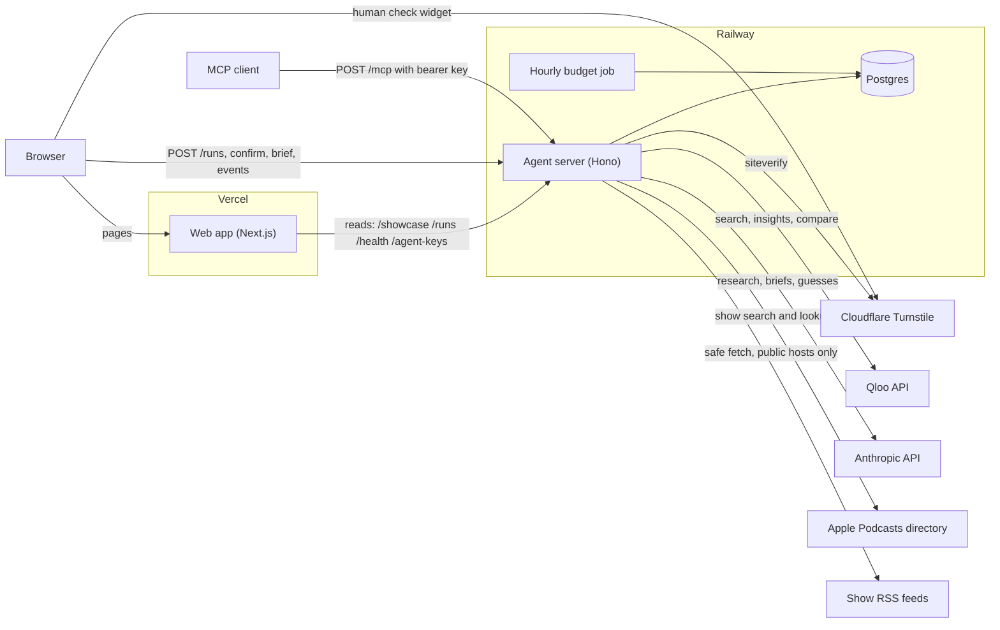
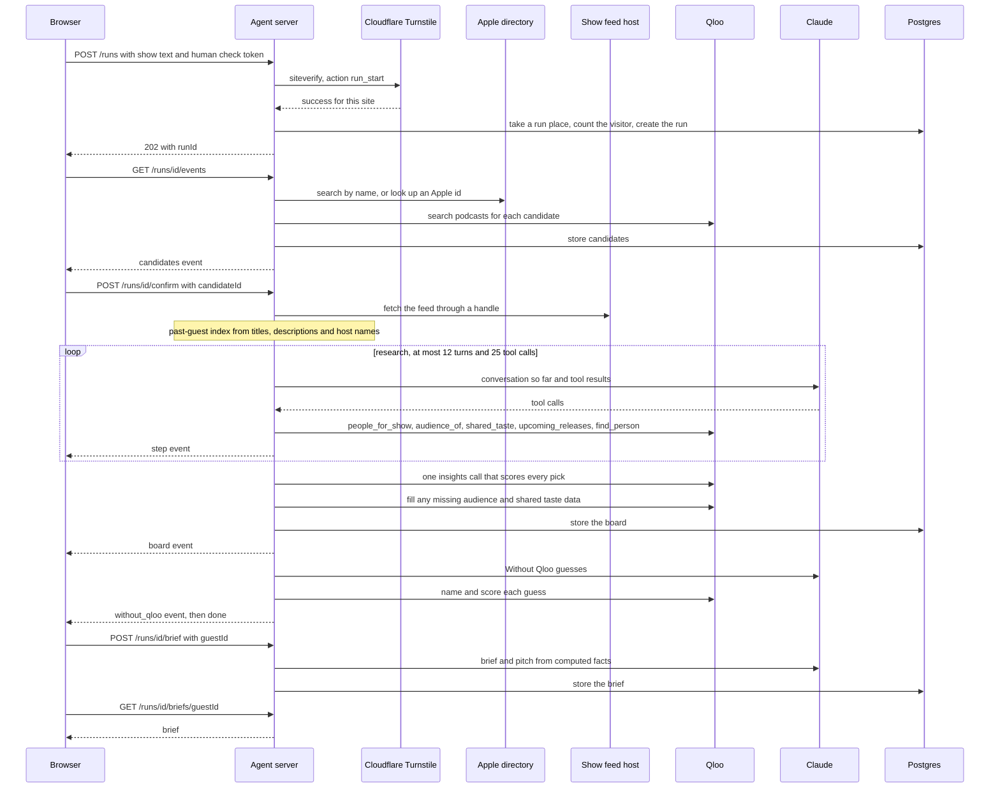
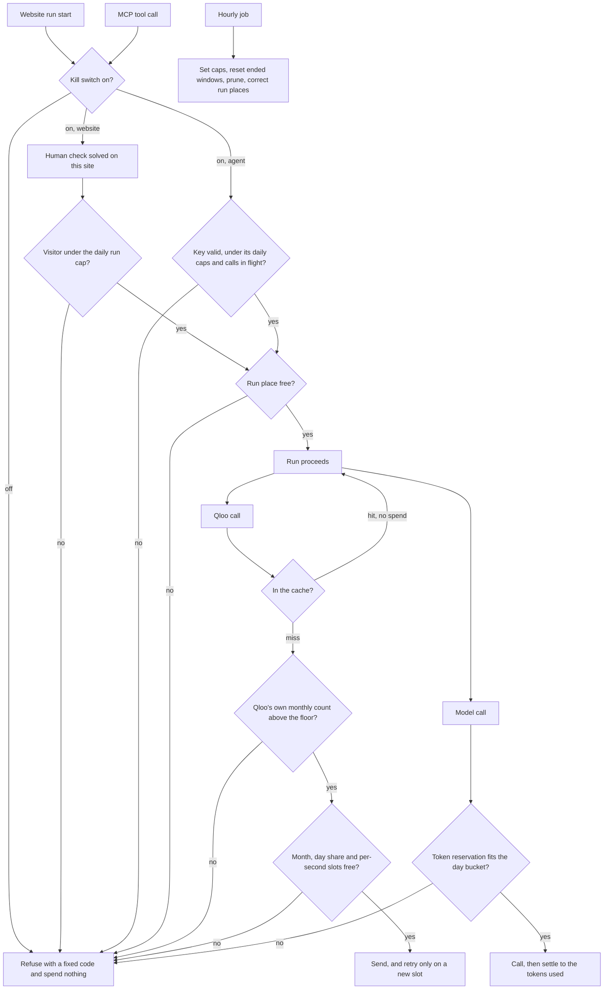

Vasal has two deployed programs and a few services around them. The web app on Vercel shows pages. The agent server on Railway does all the work that costs money, and Postgres on Railway remembers it. The same three diagrams are in [ARCHITECTURE.md](https://github.com/ramakrishnanhulk20/Vasal/blob/main/ARCHITECTURE.md) in the repo.

## The system

The web app serves the pages and reads finished runs from the agent server. The browser starts runs, follows their events and asks for briefs by calling the agent server directly, so every check that protects spending lives in the agent server. Agents reach the same server at `/mcp` with a bearer key. Postgres holds runs, boards, briefs, the Qloo cache, the spending counters and the on and off switches. An hourly job on Railway sets the day's caps, prunes expired rows and corrects the run counters.

## One run

A run has two halves because the host confirms which show they meant. The first half starts at `POST /runs` and ends with a list of candidate shows. The second half starts when the host confirms one and ends with the board. Briefs come later, one guest at a time, on request. The event stream sends each step as it happens, and a saved run replays the same events.

## Where the money is guarded

Every Qloo call and every model call reserves from a counter in Postgres before it goes out, in one statement that adds to the counter only if the total stays under the cap. A Qloo call takes one slot from the month, the day share and the current second together, or none at all. Model tokens are reserved before the call and settled to the tokens the reply reports. Visitors and agent keys have their own daily caps, and the number of runs in progress is capped across the site. The hourly job rolls the day and month windows and sets the caps from `packages/agent/scripts/budget-policy.json`. [Security and limits](/docs/security-and-limits) lists the numbers.

## The parts

### The web app, on Vercel

A Next.js app. It holds no database and no secret. It renders the home page, the saved run pages, the agents page, the proof page and these docs. Its server components read the agent server through `VASAL_API_URL`, and its browser code calls the agent server through `NEXT_PUBLIC_VASAL_API_URL`. Both default to `https://api.vasal.site`. The table at the end of [ARCHITECTURE.md](https://github.com/ramakrishnanhulk20/Vasal/blob/main/ARCHITECTURE.md) lists every route the web app calls.

### The agent server, on Railway

A Hono server on Node. It exposes the routes in [API and MCP](/docs/api-and-mcp), runs the agent, holds the Qloo and Anthropic keys, and enforces every cap. It takes a visitor's address only from the header the host's edge sets, which a client cannot write. The `prove` command checks that Railway's edge replaces a client-written `X-Real-IP`. The server assumes one process per database. On start it fails any run a dead process left unfinished and resets the in-progress counters. On shutdown it gives runs and briefs in flight 12 seconds to finish.

### Postgres, on Railway

Two roles share one database. The owner role runs migrations, budgets and pruning, and only operator scripts use it. The limited `vasal_app` role is the one the server uses. It cannot change the schema, the switches, the caps, or the showcase table. Once a run is promoted to the showcase, a database trigger stops that role from changing any of the run's rows, whatever the code does. Visitor addresses are stored only as a keyed hash and are deleted after two days. Agent keys are stored only as SHA-256 hashes.

### The hourly budget job

A Railway cron service runs `ops nightly` every hour: it sets today's caps from the budget policy, prunes expired rows, and lowers the in-progress counters to the runs that really hold them. Each step runs even when another fails. Every budget window stays open until 02:00 UTC after its nominal end, so a late job never leaves visitors refused at midnight.

### Qloo

Qloo's taste graph, reached at `https://hackathon.api.qloo.com` with the hackathon key in an `X-Api-Key` header. Every call goes through one metered client: cache first, then the meter, then the network. [Every Qloo call](/docs/qloo-calls) lists them.

### Anthropic

The research model, the brief writer and the Without Qloo guesses all call Anthropic's API. The model is set by `VASAL_MODEL` and defaults to Claude Haiku 5.5. Every call reserves its tokens first and settles to the tokens the reply used.

### Podcast directories and feeds

Apple's podcast search is the directory. The server asks it for up to 5 matches, at most 20 requests a minute, and keeps answers for an hour. A show's RSS feed is fetched through a fetcher that dials only public internet addresses, follows at most 3 redirects, caps the download and refuses any document with a DOCTYPE.

### Cloudflare Turnstile

The human check. The browser shows the widget. The server asks Cloudflare to verify the answer, and accepts it only if it succeeded, was solved on this site's hostname, and was solved for this action. A run start and a key request use different actions, so an answer for one cannot be spent on the other.
