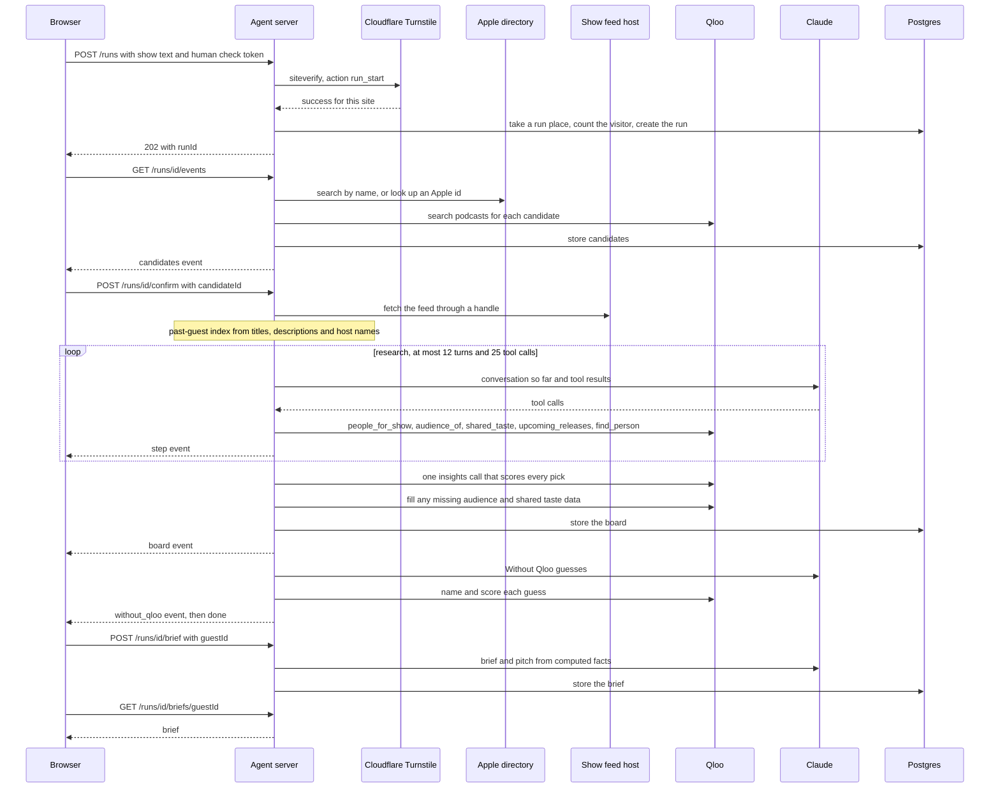

A run turns a show name into a ranked board of guests. Code does the counting and the checking. The AI model picks which Qloo questions to ask and writes a sentence of prose for each guest. The diagram shows the whole path, and the sections below take it in order.

## The input

The host types one line into the box on the home page: a show name, an Apple Podcasts link or an RSS feed link. The text is trimmed and limited to 300 characters. The site also sends the answer to the human check, which Cloudflare's Turnstile widget produces.

The server decides what the line is with the standard URL parser, never with a guess:

- A link is an Apple Podcasts link only when its host is exactly `podcasts.apple.com` and its path has an `id` followed by 3 to 12 digits. The server never fetches the Apple page. It looks the id up.
- Any other `http` or `https` link is a feed link.
- Everything else is a show name, searched as plain text.

## Finding the show

For a name, the server asks Apple's podcast directory for up to 5 matches. For an Apple link, it looks up that one show. For a feed link, it downloads the feed once and takes the show's title from it, with the link's host as the publisher. Answers from the directory are kept for an hour, and Apple is asked for at most 20 requests a minute across the whole server.

Each candidate then gets one Qloo search for a podcast. A candidate stays only if Qloo has exactly one podcast that matches its name. An exact name match wins. Only when there is none does a name that is the other followed by more words count, and if two different Qloo podcasts tie at the winning level, the candidate is dropped rather than guessed. Candidates that point at the same Qloo podcast collapse to the first one in Apple's order, so a lookalike listing can never lend its feed to the real show.

The host sees the candidates under "Which show did you mean?" and picks one. The browser sends back only the candidate's id, issued by the server for that run. It cannot send a link or a name at this step, so it cannot steer the server to fetch something else. The pick must come within 30 minutes of the run starting.

Where a show came from matters later. A show found by a name search is called `directory`. An Apple link the visitor gave is `linked`, and a feed link is `pasted`. Only a `directory` show's episode titles ever reach an AI model, because anyone can list a lookalike show and hand out its link.

## The past-guest check

When the host confirms, the server downloads the show's feed. It reads the newest 2,000 episodes at most, with 5 seconds to connect and 15 seconds in all, and it refuses any address that is not on the public internet. Only a feed it was handed for this run can be fetched, and the AI model has no tool that fetches anything.

From the feed it builds an index of three things: every episode title, every episode description, and the names of the people who make the show (the directory name, the publisher, Qloo's name for the show, the feed title and the feed's author and owner names). Every person who comes back from Qloo is checked against it before the model sees them.

- A title or a host entry matches when it holds every word of the person's name as whole words, in any order. "Peyton and Eli Manning" matches Peyton Manning, and a trailing Jr, Sr, II, III or IV is ignored.
- A description matches only on the whole name, or the first and last name side by side, because descriptions mention people in passing.
- Accents, punctuation and initials are folded, so "Beyonce" matches Beyoncé and "J.J. Watt" matches "JJ Watt".

A match removes the person for the rest of the run. The cost of a false match is one missing person, and it can never add anyone. The run records how far back the check reached, in a step that reads `Read <count> episode titles back to <month year> from the show's feed`, with the count and the month written by code. If the feed cannot be read, the run says past guests were not checked instead of implying there were none. Hosts are still left out in that case. The check cannot catch a guest who is named only by a nickname, a misspelling or a feed that does not reach back far enough.

## The agent loop

The research model is Claude Haiku 5.5 by default, set by `VASAL_MODEL`. It gets a fixed system prompt, the Qloo name of the show in quotes, and eight tools. It never sees anything the visitor typed, and it never sees the exclusion list.

| Tool | What it does | Most calls per run |
| --- | --- | --- |
| `people_for_show` | Lists up to 20 people whose fans overlap most with the show's audience, best first. It can limit the list to less famous people. | 3 |
| `audience_of` | Reads a person's audience by age band and gender. | 10 |
| `trend_of` | Reads whether interest in a person is rising. Off by default. | 10 |
| `shared_taste` | Reads the tastes the show's audience and the person's audience share. | 10 |
| `upcoming_releases` | Lists upcoming films, TV shows or books the audience is likely to care about, as titles only. | 3 |
| `find_person` | Looks up a name and returns up to 3 matches. | 6 |
| `recent_episode_titles` | Shows the newest episode titles, so the model sees what the show covers. | 1 |
| `finish_board` | Submits 3 to 10 picks, each a person and a one-sentence angle. | 2 |

Code enforces every limit, never the model's good manners. A run has at most 12 model turns, 25 tool calls, 250,000 tokens and 120 seconds, counted from the host's confirm. Past a limit the run ends as failed and what it spent stays counted. A tool call with a person id that no earlier tool returned in this run is refused with no Qloo call. The same holds for an unknown tool and for input that does not match the tool's strict schema.

`trend_of` is off because Qloo's hackathon host returned no trend data on 21 Oct 2026. With the default setting no run calls it, and every guest's rising state is "unknown" rather than a guess.

## Which Qloo calls happen and why

A run asks Qloo six kinds of question: which podcast the show is, which people its listeners love, who a person's fans are, which tastes the two audiences share, which films, shows and books are coming, and who a name belongs to. Then one final question scores every pick at once. [Every Qloo call](/docs/qloo-calls) lists each request with its parameters, how often a run makes it and how the meter counts it.

## How fit, reach and the rest are computed

Every number on a board is computed in code from Qloo's answers.

- Fit: after the research, one Qloo call scores all the picks together against the show. It asks for the affinity of each person given the show as the signal. All fits on the board come from that one call, so they sit on one scale and compare with each other. The fit is the affinity rounded to two decimals, shown as a percentage. Guests rank by their unrounded affinity, with ties broken by lower popularity and then by pick order. A person Qloo does not score shows "not scored" and ranks last.
- Household name: Qloo gives each person a popularity from 0 to 1. At 0.97 or above the board shows "household name". A calibration on 30 people on 25 Oct 2026 found that below that line Qloo's popularity cannot tell a famous guest from an unknown one, so no other band is named. A missing label says nothing about how easy a guest is to book.
- Leans toward: code compares the guest's fans with the show's listeners across the documented age bands and genders. It keeps a group where the guest's fans index above average and the show's listeners do not, takes the largest gap, and prints a fixed label such as "women" or "listeners 25 to 29". This is a lean, not proof that the show has none of those listeners.
- Shared tastes: Qloo's comparison of the two audiences returns tags. Code keeps the top five from tag families that describe a work or a conversation, such as genre, style and tone, and drops any tag that names an identity, a faith, health, crime or politics. A dropped tag costs nothing.
- People who have died: a person Qloo marks with a death date is removed wherever the date shows up.
- People found only by name: a person who came only from `find_person` stays on the board only if Qloo scores them 0.5 or higher for the show.

The board then keeps the picks that survive these checks. Fewer than 3 guests fails the run as `AGENT_BOARD_TOO_SMALL`. Nothing is padded.

## What the model writes, and what it may not claim

The model writes one sentence per guest, the angle, and later the brief. Code checks every sentence it writes before the text is stored.

- No numbers: any digit, and any number word on a fixed list (two and above, ordinals from "second", "double", "halved", "tenfold", "decade", "dozen" and similar), sends the sentence back once for a rewrite. A second failure fails that step. An angle has no placeholders, so it holds no number. In a brief, a number appears only where the model writes a placeholder such as the fit, and code fills it in.
- No links, emails or phone numbers: any found are removed. A brief's step records how many were taken out of the draft.
- No release claims: Qloo lists upcoming releases without their casts, so nothing Vasal writes may say a person has a film, show, book or album coming out. Phrases such as "her new film" or "out next month" are refused, and so is an angle that names a title `upcoming_releases` returned.
- No family claims: spouse, marriage, children and parenthood words are refused.
- No sensitive traits: words that almost always claim a person's sexuality, gender identity or a named health condition are refused. The prompts also forbid religion, ethnicity and politics, which are everyday topics in prose and so stay prompt rules.
- No accusations: arrests, charges, lawsuits and scandals are refused.
- No trend claims without data: an angle may not call anyone rising unless the data says so.

No word list catches every way of saying something, so the prompts forbid the rest and the lists catch the common ones. The pitch on the page carries an "AI draft" label, and MCP results label angles and briefs as AI drafts.

## The board

The board is stored once and never changes. Each guest holds a name, fit, rank, reach label, rising state, the "leans toward" group, up to five shared tastes and the angle. A kolam, the line drawing on the board page, is drawn from the guests' ids, ranks and tag counts only, never from any third-party text. A run that stops early is saved as failed and shows no board. Partial results are never shown as complete.

The same model is then asked for guests with no Qloo data, and Qloo names and scores its guesses. That is the [Without Qloo](/docs/without-qloo) tab. It is best effort: if it fails, the board is unaffected.

## The brief and the pitch

A brief is written on demand, one guest at a time, and stored. The first request claims the guest's brief before any model call, so ten clicks make one call. A run can write at most 5 briefs. A failed brief may be asked for once more.

The model gets the facts as placeholders: the guest, the show, the fit, the reach sentence, the rising state, the lean and the shared tastes. It never gets a name or a figure it could copy, so every name and number on screen is filled in by code afterwards. It writes the reason the guest suits the show, an angle, five questions, a subject line and an email body under about 150 words. The reach and lean notes are for the host, so they are not allowed in the email to the guest's team. A draft that fails any check is written again once, and a second failure fails the brief with `AGENT_BAD_PROSE`. Vasal never sends the pitch.

## The live step stream

While a run works, the page follows `GET /runs/:id/events`, a server-sent event stream. Every frame is one event name from a fixed list (`step`, `candidates`, `board`, `brief`, `without_qloo`, `done`, `failed`) and one line of JSON. A step's label is written by code from fixed words, counts and at most a Qloo name, so no model text and no tool input is streamed. The server closes the stream when the run is done or failed, once the candidates are out, or after 10 minutes. The page opens a new one after the host confirms. A visitor can hold 6 streams, a run 3, and the server 100. The [API and MCP](/docs/api-and-mcp) page lists the events and their fields.

## When a run fails

A run that fails is saved as failed with a short code and no board, and the page shows a plain-English reason. The daily run it used stays counted. The codes include `SHOW_NOT_FOUND`, `SHOW_NO_QLOO_MATCH`, `FEED_UNAVAILABLE` (a pasted feed link that cannot be read), `AGENT_LIMIT`, `AGENT_BOARD_TOO_SMALL`, `QLOO_BUDGET` and `MODEL_BUDGET` (the day's budget is spent) and `CONFIRM_EXPIRED`. See the [FAQ](/docs/faq) for what to do about each.
